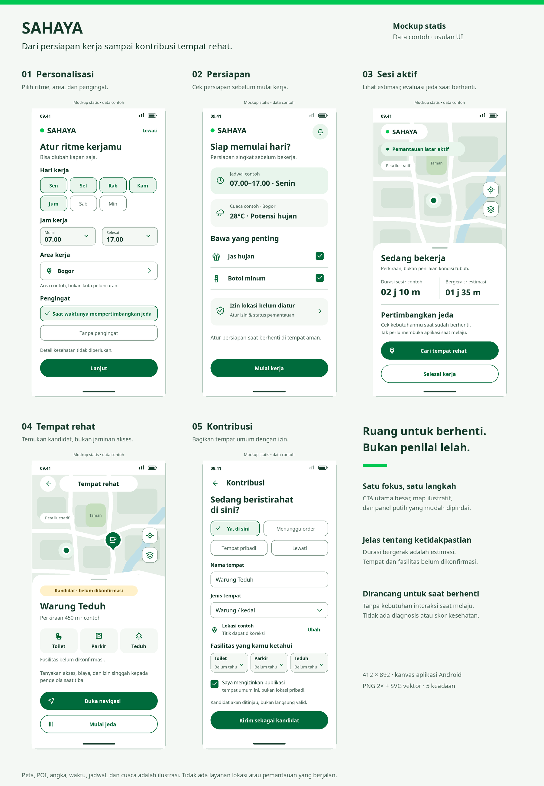
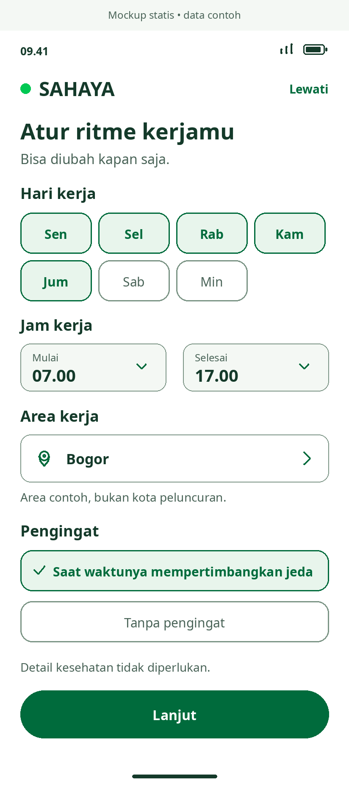
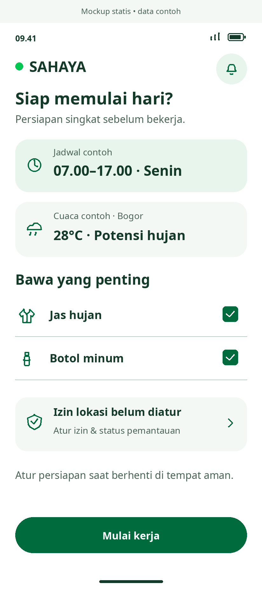
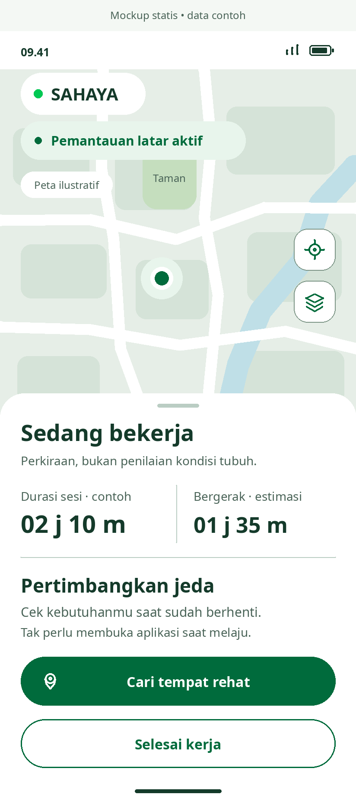
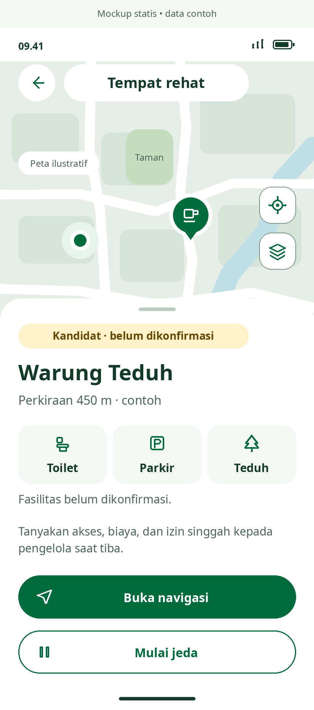
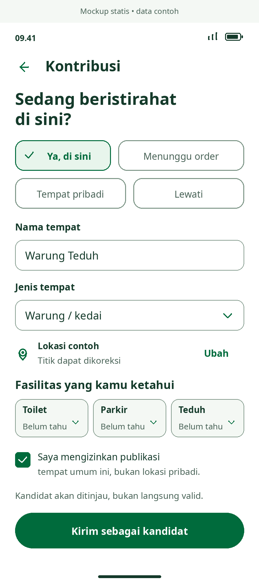

# SAHAYA — rancangan UI statis

> **Mockup statis • data contoh.** Bukan aplikasi, prototipe interaktif, tangkapan emulator, atau bukti fitur sudah berjalan. Lima layar ini merupakan usulan arsitektur UI oleh asisten; yang sudah dikonfirmasi pengguna adalah arah merek hijau dan referensi visual Gojek, bukan seluruh keputusan produk.

Kembali ke [00 Mulai di Sini](../00%20Mulai%20di%20Sini.md) · Konteks [05 SAHAYA - Brief Tim](../05%20SAHAYA%20-%20Brief%20Tim.md) · Cakupan [06 SAHAYA - MVP dan Validasi](../06%20SAHAYA%20-%20MVP%20dan%20Validasi.md).

## Ringkasan visual

Urutan bermakna: **personalisasi → persiapan → sesi aktif → kandidat tempat rehat → kontribusi setelah berhenti**. Pilihan yang dipakai: penulisan SVG dan PNG offline dengan satu lapisan perintah gambar, bukan generator gambar atau implementasi aplikasi. Ini menjaga konsistensi, teks dapat diedit, dan proses bisa diulang tanpa layanan/API atau instalasi. Konsekuensinya: peta merupakan diagram sendiri, bukan ubin peta atau lokasi nyata; tidak ada foto.

## Lima layar

### 1. Personalisasi

Hari kerja, rentang jam, area contoh, dan pilihan pengingat; **Lewati** tetap tersedia. Detail kesehatan tidak diminta. Bogor hanya contoh area, **bukan keputusan kota peluncuran**. Jadwal yang terlihat adalah data contoh, bukan jadwal pengguna yang telah disimpan.

### 2. Persiapan

Jadwal dan **cuaca contoh** dipisahkan dari daftar jas hujan/botol minum. Masuk ke pengaturan izin dan status pemantauan ditampilkan sebelum **Mulai kerja**. Hujan, suhu, dan hari tidak berasal dari prakiraan aktual. Centang checklist hanyalah keadaan contoh, bukan konfirmasi barang milik pengguna.

### 3. Sesi aktif

Peta ilustratif memimpin komposisi. Indikator **Pemantauan latar aktif** adalah spesimen keadaan UI yang kelak memerlukan dukungan OS, izin, dan notifikasi nyata. **Durasi sesi** berbeda dari **estimasi bergerak**; angka tidak menyatakan deteksi kerja atau kesehatan yang akurat. Panel mengajak mempertimbangkan jeda, bukan mendiagnosis lelah. **Cari tempat rehat** dan **Selesai kerja** diakses setelah berhenti; alur tidak mensyaratkan interaksi saat melaju.

### 4. Kandidat tempat rehat

**Warung Teduh adalah nama fiktif/contoh.** Jarak 450 m adalah perkiraan ilustratif. Status **Kandidat · belum dikonfirmasi** dan **Fasilitas belum dikonfirmasi** mencegah atribut toilet, parkir, dan teduh terbaca sebagai verifikasi. Tidak ada jaminan toilet gratis, lahan publik, akses, atau izin singgah; pengguna diminta bertanya kepada pengelola. **Buka navigasi** mengusulkan handoff ke aplikasi navigasi, bukan mesin rute milik SAHAYA. **Mulai jeda** merupakan pilihan terpisah.

### 5. Kontribusi setelah berhenti

Pertanyaan membedakan istirahat, menunggu order, tempat pribadi, dan melewati kontribusi. Formulir contoh memakai jenis warung/kedai, lokasi yang dapat dikoreksi, dan fasilitas **Belum tahu**. Rancangan pilihan fasilitas selanjutnya: Ada / Tidak ada / Belum tahu, dengan opsi koreksi; dropdown terbuka belum digambar. Checkbox yang terlihat dicentang hanya spesimen keadaan **persetujuan eksplisit**, bukan izin otomatis/default. Hanya tempat umum yang boleh dibagikan, bukan lokasi pribadi. **Kirim sebagai kandidat** tidak langsung menghasilkan tempat terverifikasi.

Dua kiriman dari satu orang **bukan dua konfirmasi independen**. Ambang seperti **5 pengemudi berbeda / 2 kunjungan berulang masih terbuka**, tidak difinalkan oleh mockup ini. Sumber, deduplikasi identitas, masa berlaku, moderasi, dan pencabutan izin perlu dirumuskan sebelum implementasi.

## Bahasa visual dan token

Mode **Operate**: mudah dipindai saat berhenti di luar ruangan, bukan tampilan promosi. Satu CTA utama per layar, margin horizontal 24 unit, jarak antarkelompok minimal 8 unit, tombol utama tinggi 56 unit, target kontrol terdefinisi minimal 48 × 48 unit. Target ini hanya geometri rancangan, belum area sentuh native yang berfungsi.

| Token | Hex persis | Pemakaian |
|---|---|---|
| brand | `#00C853` | Aksen merek cerah, titik wordmark, garis papan; bukan latar teks putih |
| primary | `#006B3C` | Tombol, pilihan aktif, ikon, teks aksi |
| ink | `#143A2A` | Judul dan isi utama |
| muted | `#496357` | Teks pendukung |
| white | `#FFFFFF` | Kanvas aplikasi dan bottom sheet |
| mint | `#E8F5EC` | Pilihan aktif/status pendukung |
| paper | `#F4F8F4` | Permukaan sekunder dan area luar aplikasi |
| line | `#BACDC3` | Divider dekoratif dan handle, bukan satu-satunya penanda kontrol |
| outline | `#7B9485` | Batas input dan kontrol tidak terpilih |
| map | `#E6EEE7` | Latar peta ilustratif |
| block | `#D5E3D8` | Blok ilustratif |
| park | `#C5DEBE` | Area taman ilustratif |
| water | `#BFDFE7` | Aliran air ilustratif |
| amber | `#FFF1CA` | Status kandidat, bukan error |
| on_amber | `#644700` | Teks pada status kandidat |

**Tipografi:** Noto Sans Regular dan Bold dari font lokal yang hash-nya dicatat di manifest. Isi utama/tombol 16 unit, judul layar 26–28, judul bagian 18–22; label pendukung 14–15. Metadata kecil 12–13 hanya untuk status, label map, dan nilai pendukung, bukan instruksi utama. Angka menggunakan face yang sama, bukan monospace dekoratif. SVG menyebut `Noto Sans` dan tidak menyematkan font; sediakan font tersebut agar metrik tetap sama. PNG menjadi spesimen visual final yang tidak bergantung pada font di mesin pembaca.

**Kontras statis terukur:** minimum teks seluruh layar 4,544:1; putih di tombol hijau gelap 6,628:1. Outline pada putih 3,273:1 dan pada paper 3,051:1. Hijau cerah tidak dipakai untuk teks kecil/teks putih. Ikon merupakan garis geometris yang digambar sendiri dengan stroke konsisten, tanpa emoji, logo Gojek, atau glyph sebagai pengganti ikon. Ini bukan sertifikasi aksesibilitas menyeluruh.

## Referensi dan berkas publik

Arah visual mengikuti inspirasi pengguna: merek hijau, peta ilustratif, panel putih dan CTA besar. Logo, foto, dan aset Gojek tidak didistribusikan ulang. Peta pada mockup digambar sebagai ilustrasi, bukan data lokasi nyata.

Lima layar tersedia sebagai PNG 824 × 1856 dan SVG 412 × 928. Papan ringkasan PNG berukuran 1800 × 2600. Berkas PNG adalah spesimen visual final; SVG tidak menyematkan font. Sumber render, laporan pemeriksaan dan manifest lokal tidak disertakan dalam snapshot publik ini.

## Belum digambar atau diuji

Izin ditolak/terbatas, layanan latar dihentikan OS, lokasi dimatikan/tidak akurat, offline, cuaca gagal, kandidat kosong/tidak tersedia, akses ditolak, navigasi tidak tersedia, dropdown/picker terbuka, checkbox persetujuan belum dipilih, validasi form, kirim gagal/duplikat/sukses, moderasi, koreksi/hapus kontribusi, konfirmasi selesai kerja, dan ringkasan sesi. Loading, error, keyboard/IME, TalkBack, mode gelap, layar besar, font scaling, baterai, notifikasi latar, sensor, dan gesture native belum divalidasi. Tidak ada data kesehatan, skor tubuh, testimoni, angka adopsi, atau klaim implementasi/rilis.
