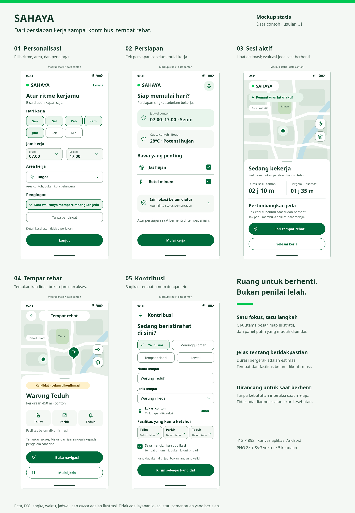

# SAHAYA

**Pendamping kesehatan kerja untuk driver ojek online.**

SAHAYA dirancang untuk membantu driver mempersiapkan kerja, mengevaluasi kebutuhan jeda, dan menemukan tempat rehat dengan fasilitas yang relevan. Pengetahuan tempat dapat dibangun bersama komunitas melalui kontribusi dan konfirmasi yang sukarela.

> **Status: konsep, dokumentasi, dan mockup statis.** Repositori ini belum berisi aplikasi Android, backend, atau layanan pemantauan yang berjalan. Data pada gambar bersifat ilustratif; belum ada klaim dampak kesehatan maupun hasil uji driver.

## Ringkasan visual

## Alur produk

1. **Personalisasi** — pilih hari, jam, area kerja, dan preferensi pengingat.
2. **Persiapan** — tinjau konteks cuaca dan checklist perlengkapan sebelum bekerja.
3. **Sesi aktif** — mulai sesi dan perkirakan pola bergerak/berhenti dengan izin yang jelas.
4. **Tempat rehat** — temukan kandidat tempat dan periksa informasi fasilitas sebelum singgah.
5. **Kontribusi** — setelah berhenti aman, laporkan atau koreksi tempat umum dengan persetujuan.

Kondisi diam tidak otomatis berarti istirahat. Estimasi gerak bukan diagnosis kelelahan. Tempat kandidat dan fasilitas yang belum dikonfirmasi harus tetap ditandai demikian.

## Dokumentasi

- [Beranda dokumentasi](Obsidian/00%20Mulai%20di%20Sini.md)
- [Brief tim: masalah, sasaran, alur, dan pembeda](Obsidian/05%20SAHAYA%20-%20Brief%20Tim.md)
- [MVP, kriteria penerimaan, dan rencana validasi](Obsidian/06%20SAHAYA%20-%20MVP%20dan%20Validasi.md)
- [Evaluasi potensi dan risiko ide](Obsidian/07%20SAHAYA%20-%20Evaluasi%20Ide.md)
- [Penjelasan desain UI](Obsidian/Desain/01%20Desain%20UI.md)
- [Ringkasan guidebook lomba](Obsidian/01%20Guidebook.md)
- [Tema dan arah konsep](Obsidian/02%20Tema%20dan%20Ide.md)
- [Checklist keperluan](Obsidian/03%20Checklist%20Keperluan.md)
- [Jadwal yang dicatat dari guidebook](Obsidian/04%20Deadline.md)

Catatan lomba adalah ringkasan dokumentasi, bukan pengumuman resmi. Perubahan panitia perlu diperiksa terpisah.

## Mockup per layar

- [01 — Personalisasi](Obsidian/Desain/Aset/01-personalisasi.png)
- [02 — Persiapan](Obsidian/Desain/Aset/02-persiapan.png)
- [03 — Sesi aktif](Obsidian/Desain/Aset/03-sesi-aktif.png)
- [04 — Tempat rehat](Obsidian/Desain/Aset/04-tempat-rehat.png)
- [05 — Kontribusi](Obsidian/Desain/Aset/05-kontribusi.png)

PNG tersedia sebagai spesimen visual; versi SVG berada di folder yang sama. Bogor, nama tempat, peta, cuaca, dan angka pada mockup hanyalah contoh, bukan hasil integrasi live.

## Ruang lingkup dan keputusan terbuka

Fokus konsep adalah **persiapan → konteks sesi → ajakan jeda → tempat rehat → kontribusi komunitas**, dengan kaitan konseptual ke SDG 3: Good Health and Well-Being.

Android, sesi manual, dan pilot satu wilayah merupakan rekomendasi, bukan keputusan final. Platform/stack, wilayah pilot, provider peta, backend, ambang konfirmasi, dan retensi lokasi masih perlu diputuskan.

Di luar fokus awal: diagnosis kelelahan, optimasi pendapatan, integrasi order platform ojol, navigasi turn-by-turn sendiri, dan pelacakan sepanjang hari.

## Membuka di Obsidian

Unduh atau clone repositori, lalu pilih **Open folder as vault** dan buka folder `Obsidian`. Tautan catatan menggunakan Markdown standar agar dapat dibaca di GitHub maupun Obsidian.

Repositori ini merupakan **snapshot publik manual** dari dokumentasi lokal, bukan sinkronisasi otomatis. Pengaturan Obsidian, metadata sinkronisasi, tautan dokumen kerja tim, PDF pihak ketiga, dan gambar referensi Gojek tidak disertakan. Tidak ada afiliasi atau integrasi resmi Gojek/Grab yang diklaim.
